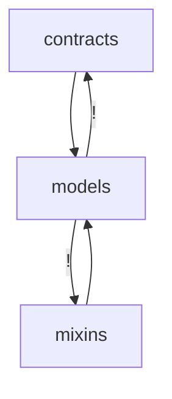

<!---
Generated by https://github.com/polina-c/layerlens
Dependencies that create loops (inversions) are marked with `!`.
-->

[../](../DEPS.md)
domain /
[contracts](contracts/DEPS.md) |
[models](models/DEPS.md)

### Inversions

In this folder: 2

Including sub-folders: 6
